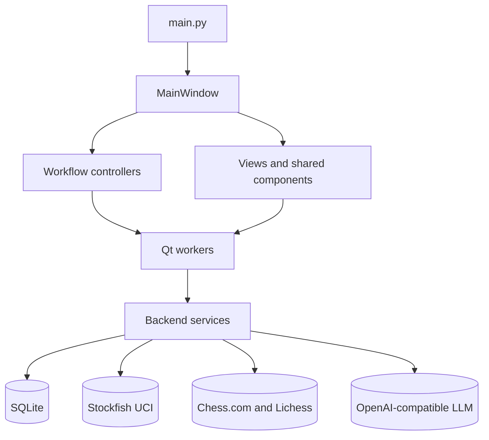

# Architecture

Chess Analyzer Pro is a local-first PyQt6 desktop application. Stockfish
analysis, PGN import, history, opening books, metrics, and tactics run on the
user's machine. Chess.com/Lichess imports and AI coaching are optional network
features.

Hard engineering rules live in [AGENTS.md](AGENTS.md), code patterns in
[docs/conventions.md](docs/conventions.md), and step-by-step changes in
[docs/recipes.md](docs/recipes.md).

---

## 1. Shape



The dependency direction is:

```text
main.py -> src/gui -> src/workers -> src/backend -> src/utils
```

`src/workers` is the Qt bridge: it owns `QThread` subclasses and emits signals
back to the GUI. `src/backend` is pure Python. `src/gui` renders state and
dispatches user actions; it does not calculate chess or domain results.

### Allowed edges

- `gui` -> `backend`, `config`, `utils`, `constants`
- `workers` -> `backend`, `config`, `utils`
- `backend` -> `utils`, `constants`, `config` (settings schema only)
- `utils` -> `constants`

### Forbidden edges

- `backend`, `utils`, or `config` importing PyQt6 or `src.gui`
- domain calculations in widgets or repositories
- network calls from the GUI thread
- importing `src.gui.components` subpackages instead of its public facade
- `QThread` subclasses outside `src/workers`

Boundary guards live in `tests/architecture/test_boundaries.py`,
`tests/gui/test_button.py`, and `tests/gui/test_input.py`.

---

## 2. Package responsibilities

| Area | Responsibility |
| --- | --- |
| `src/backend/analysis` | Engine orchestration, classification, metrics, tactics, variations, opening data |
| `src/backend/api` | Chess.com and Lichess clients, import limits, shared download helpers |
| `src/backend/cache` | API response cache facade |
| `src/backend/domain` | Shared domain rules such as termination detection |
| `src/backend/engine` | Stockfish release discovery, download, and binary validation |
| `src/backend/models` | Lightweight cross-layer models |
| `src/backend/services` | LLM and feedback integrations |
| `src/backend/storage` | SQLite schema, repositories, migrations, PGN parsing, backup |
| `src/backend/updater` | Release checks and platform installer dispatch |
| `src/config` | Single-source settings metadata and defaults (Qt-free) |
| `src/workers` | Qt workers for analysis, imports, metrics, settings, and updates |
| `src/gui/app` | Workflow controllers for analysis, batch analysis, and game loading |
| `src/gui/main_window` | Window composition and navigation, theme, status, tour, update, and variation mixins |
| `src/gui/views` | Pages and page-specific sub-widgets |
| `src/gui/analysis` | Analysis tabs, move list, coach, variation mode, and live engine lines |
| `src/gui/board` | Board, evaluation bar, board panel, piece themes, mini boards |
| `src/gui/components` | Shared component library, grouped by responsibility |
| `src/gui/dialogs` | Load game, setup wizard, feedback, errors, and updates |
| `src/gui/engine_lines` | Shared live-engine session and engine-lines widget |
| `src/gui/import_workspace` | Multi-game import table hosted by History |
| `src/gui/share` | Shareable game report rendering and export |
| `src/gui/theme` and `src/gui/styles` | Palettes, tokens, motion, QSS template, and the `Styles` facade |
| `src/utils` | Logger, config persistence, paths, resources, secrets |

---

## 3. Reading paths

| If you need to... | Read |
| --- | --- |
| See how the app is wired | This file |
| Trace a click or a background job | [docs/architecture/runtime-flows.md](docs/architecture/runtime-flows.md) |
| Change tactics or AI coaching | [docs/architecture/tactics.md](docs/architecture/tactics.md) |
| Change storage, history, or termination | [docs/architecture/storage.md](docs/architecture/storage.md) |
| Change UI, components, or theming | [docs/architecture/gui.md](docs/architecture/gui.md) |
| Follow a code pattern or find a shared helper | [docs/conventions.md](docs/conventions.md) |
| Add a page, setting, motif, or card | [docs/recipes.md](docs/recipes.md) |
| Set up the app and make a first change | [docs/onboarding_doc.md](docs/onboarding_doc.md) |
| Follow the contribution process | [CONTRIBUTING.md](CONTRIBUTING.md) |
| Know the hard rules before editing | [AGENTS.md](AGENTS.md) |
