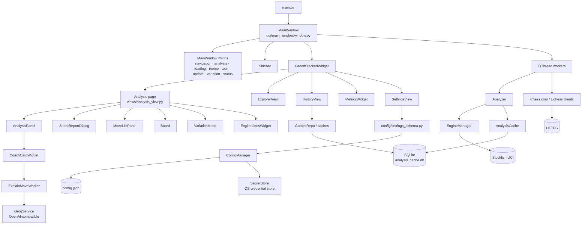

# Architecture

Canonical reference for the Chess Analyzer Pro codebase: layers, runtime flows,
every source file's purpose, the patterns we follow, and where to make common
changes. It describes the v2.6.1 layout.

**Audience:** new contributors, maintainers, and AI agents working in the repo.
For setup and a first change, read [onboarding_doc.md](onboarding_doc.md); for
process rules, read [CONTRIBUTING.md](../CONTRIBUTING.md); for agent guardrails,
read [AGENTS.md](../AGENTS.md).

---

## 1. Reading guide

1. [System overview](#2-system-overview) — how the pieces fit together.
2. [Runtime flows](#3-runtime-flows) — what happens when you click something.
3. [File reference](#4-file-reference) — what each module is for.
4. [Patterns](#5-patterns-we-follow) — the rules that keep the codebase coherent.
5. [Invariants](#6-domain-invariants) — never regress these.
6. [Extension recipes](#7-extension-recipes) — step-by-step for common changes.
7. [Task index](#8-task--file-index) — jump straight to the right file.

---

## 2. System overview



### Layers and dependency direction

```text
main.py
  └── src/gui/**        presentation only (PyQt6)
        └── src/backend/**   domain logic (zero Qt imports)
              └── src/utils/**, src/constants.py   leaf helpers
```

Allowed edges:

- `gui` → `backend`, `gui` → `utils`, `gui` → `constants`, `gui` → `config`
- `backend` → `utils`, `backend` → `constants`, `backend` → `config` (schema only)
- `utils` → `constants`; `utils` never imports `gui` or `backend`
- `config` → `constants` (Qt-free)

Forbidden edges:

- `backend` importing PyQt6 or any `src.gui` module
- `utils` importing `src.gui`
- widgets importing `src.gui.components.<subpackage>` directly (use the facade)
- business logic living in a widget or repository
- network calls from the UI thread

### Package responsibilities

| Area | Responsibility |
| --- | --- |
| `src/backend/analysis` | Engine orchestration, classification, metrics, tactics, variations, opening data |
| `src/backend/api` | Chess.com and Lichess REST clients, import limits |
| `src/backend/storage` | SQLite schema, repositories, migrations, PGN parsing, backup |
| `src/backend/services` | LLM and feedback integrations |
| `src/backend/engine` | Stockfish download and binary validation |
| `src/backend/updater` | GitHub release checks and platform installers |
| `src/config` | Single-source settings metadata and defaults (Qt-free) |
| `src/gui/main_window` | Window composition and cross-cutting mixins |
| `src/gui/views` | Full pages and their sub-widgets |
| `src/gui/analysis` | Analysis board, move list, coach, variations, live engine |
| `src/gui/share` | Model-rendered game report cards and export dialog |
| `src/gui/components` | Shared component library, grouped by responsibility |
| `src/gui/dialogs` | Modal flows (load game, wizard, feedback, errors, updates) |
| `src/gui/import_workspace` | Searchable multi-game import table hosted by History |
| `src/gui/theme` | Palettes, tokens, motion, OS theme detection |
| `src/gui/styles.py` | One QSS generator per control, driven by the live palette |
| `src/utils` | Config, logging, paths, resources, secrets |

---

## 3. Runtime flows

### Full game analysis

1. `GameLoadingMixin.load_game()` accepts a `GameAnalysis` and hands it to
   `MainWindow.setup_analysis_page()` widgets.
2. `AnalysisMixin.start_analysis()` spawns `AnalysisWorker`, which drives
   `Analyzer.analyze_game()`.
3. `Analyzer` calls `EngineManager` per position, caches results through
   `AnalysisCache`, and converts every score to White's perspective in
   `_process_analysis_results()`.
4. Progress signals update `MoveListPanel`, `Board`, `VariationGraph` and the
   status bar. `AnalysisPanel` renders the Report, Coach, and per-game Tactics
   tabs; result tabs unlock once the game has analysis.

### Live engine session

1. `LiveEngineSession` (`gui/engine_lines/session.py`) owns one Stockfish
   process and the current FEN.
2. `LiveAnalysisWorker` / session signals feed `EngineLinesWidget`.
3. Session state is mirrored into the status bar via
   `StatusBarMixin._on_live_engine_state()`.
4. On shutdown, every session is `shutdown()`-ed from `MainWindow.closeEvent()`.

### Import (Chess.com, Lichess, PGN, CSV)

1. `LoadGameDialog` hosts the source panels in `gui/dialogs/load_game/`.
2. `ApiWorker` fetches online games; `PgnIndexWorker` indexes PGN headers
   and dropped files. Both run off the UI thread.
3. `PGNParser.index_pgn_file()` / `index_pgn_text()` store header summaries
   and offsets only; no game is fully converted just to render the picker.
4. A source result with one game loads directly into Analysis. A multi-game
   result becomes a `GameBatch` and opens the History-hosted
   `GameImportView` (`gui/import_workspace/`).
5. `GameImportView` handles search, perspective/colour/result/time/history
   filters, saved-game badges, lazy board thumbnails, and selection. Table
   thumbs come from the shared cached `render_mini_board_pixmap()`; History
   cards and drill-down rows use the same renderer through
   `MiniBoardWidget`.
6. `GameImportWorker` parses selected games with `PGNParser.parse_game_stub()`
   and persists them through `GameHistoryManager.save_unanalyzed_games_bulk()`
   using `INSERT OR IGNORE`, preserving existing analyzed rows.
7. CSV import remains in `HistoryView` via its own `GameImportWorker`.

### AI move explanation

1. `CoachCardWidget` requests an explanation for the current move.
2. `ExplainMoveWorker` builds deterministic evidence from
   `backend/analysis/tactics/insight.py`: played motifs, newly hanging pieces,
   created threats, numbered main/punishment lines, line captures, second-best
   comparisons and move mechanics.
3. `backend/analysis/tactics/explanation.py` selects the dominant story and
   emits a claim sheet (`ExplanationPlan`). The same claims feed the offline
   fallback and the LLM prompt.
4. `GroqService` only rewrites the claim sheet; the reply must cite a concrete
   move from the supplied lines and is validated against all allowed SAN and
   squares. On failure or no network the deterministic claim text is used.
5. Results are cached with a configurable TTL and rendered in the Coach tab;
   “Show main line” replays the stored line through `VariationMode`.
6. Full-game summaries use `backend/analysis/game_report.py`, including per-
   moment claim sheets, and are persisted with the game.

### Variations

1. A board move, engine-line click, or “show best move” enters
   `VariationMode`.
2. `VariationMode` mutates the FEN-keyed tree in
   `backend/analysis/variation_tree.py`.
3. `VariationGraph` renders branches; `MoveListPanel` shows saved-tree badges.
4. The tree survives leaving and re-entering variation mode for the session.

### Settings

1. `src/config/settings_schema.py` defines every setting's default, type and
   validation.
2. `SettingsView` builds category cards from `gui/views/settings/*`, using
   `SettingsForm`/`SettingsBinder`.
3. `ConfigManager` persists JSON and `SecretStore` keeps credentials in the OS
   keychain.
4. “Live” settings apply immediately through `MainWindow` slots; others apply on
   save/restart.

### History

1. `HistoryFilterBar` keeps the toolbar to search, Filters, and Sort; active
   filters appear as removable tokens, while the disclosure panel holds the
   grouped result, speed, source, analysis, and ownership controls.
2. `HistoryView` builds a `GameQuery` from the bar state.
3. `GamesRepo` applies those filters in SQL and returns one page (`10` detailed
   / `15` compact); `analysis_status` is stored as a denormalised column so
   status filtering does not parse `summary_json` per row.
4. After the page renders, an idle timer prefetches the next page so scrolling
   feels instant. Filtered-out results use the shared empty state with a
   one-action recovery path.
5. `PaginationBar` and `GameListWidget` share the paging state.

### Batch analysis

1. History bulk mode pins `GameQuery(batchable_only=True)` and keeps a
   game-ID selection set in `HistoryView`; search/filter changes clear it,
   while paging and sorting preserve it.
2. `BatchAnalysisMixin` creates one persisted `AnalysisBatch`, resolves the
   engine, and starts one `BatchAnalysisWorker` QThread.
3. `BatchAnalysisRunner` (Qt-free) walks the queue sequentially and calls the
   existing `Analyzer.analyze_game()` once per game. The analyzer stops its
   Stockfish process in `finally`, so thermal-safe defaults and Chess960
   handling stay unchanged.
4. Queue items store only intent/outcome; the `games` row is the source of
   truth. Recovery and resume reconcile from stored analysis status, skip
   completed games, and resume paused games from their first unanalyzed ply.
5. `AnalysisBatchRepo` persists state, elapsed active time, item outcomes and
   order. Worker finalization updates outcomes only, so a concurrent
   reorder/remove cannot be resurrected.
6. `AnalysisCoordinator` is the app-wide gate for single analysis, batch
   analysis, live engine sessions, and deletion of the active game. While a
   batch runs, live sessions are paused and new single analyses are blocked.
7. `BatchQueueCard` renders stats, current-game progress, elapsed/ETA, and a
   reorderable **Up next** list. Up-next previews are cached and the list is
   built lazily when History is visible/expanded; pause/resume/cancel/dismiss
   flow through MainWindow signals.

---

## 4. File reference

One row per module. “Key symbols” lists the main public classes/functions, not
every helper. Package `__init__.py` files are re-export facades unless noted.

### Root

| File | Purpose | Key symbols |
| --- | --- | --- |
| `main.py` | Application entry: high-DPI setup, splash, theme bootstrap, `MainWindow` | `main()` |
| `src/constants.py` | App version, URLs, provider presets, defaults, `DEFAULT_BOARD_THEME` | `APP_VERSION`, `PROVIDERS`, `DEFAULT_BOARD_THEME` |

### `src/backend/analysis`

<details>
<summary>Analysis, metrics, tactics, variations, opening data</summary>

| File | Purpose | Key symbols |
| --- | --- | --- |
| `analyzer.py` | Orchestrates the analysis loop, caching, pause/resume and White-perspective conversion | `Analyzer` |
| `batch.py` | Qt-free sequential batch runner, reorder refresh, reconciliation and summary | `BatchAnalysisRunner`, `reconcile_batch` |
| `engine.py` | Stockfish UCI lifecycle, path resolution, thread/hash configuration | `EngineManager` |
| `engine_line.py` | Shared engine-line model for cached and live output | `EngineLine` |
| `game_report.py` | Factual dossier used to ground full-game AI summaries | `build_game_report` |
| `local_book.py` | Local opening-book manager and result model | `LocalBookManager`, `BookResult` |
| `math_utils.py` | Win-probability, accuracy and expectation helpers | `get_win_probability`, `calculate_move_accuracy`, `apply_accuracy_floor` |
| `move_classifier.py` | Classification heuristics from win-probability loss | `MoveClassifier` |
| `navigation.py` | Move-list navigation helpers shared by shortcuts | `find_critical_move` |
| `opening_db.py` | SQLite ECO opening database lookups | `OpeningDB` |
| `polyglot_book.py` | Polyglot `.bin` opening-book reader | `PolyglotBookManager` |
| `variation_tree.py` | Persistent FEN-keyed variation tree and record models | `VariationNode`, `VariationBranch` |
| `metrics_aggregator.py` | Compatibility re-export of the metrics package | `MetricsAggregator` |

</details>

#### `src/backend/analysis/metrics`

<details>
<summary>Aggregation behind the Stats dashboard and coach dossier</summary>

| File | Purpose | Key symbols |
| --- | --- | --- |
| `aggregator.py` | Orchestrates metric collection across games | `MetricsAggregator` |
| `accumulators.py` | Colour, format, opening and clock accumulators | `ColorStats`, `FormatStats`, `OpeningStats`, `ClockStats` |
| `coach_dossier.py` | Formats aggregated facts for AI Coach prompts | `build_coach_dossier` |
| `constants.py` | Thresholds and shared metric constants | — |
| `filters.py` | Game filtering and player-colour resolution | `filter_games` |
| `models.py` | Typed metric records | `Outcome`, `GameRecord` |
| `termination.py` | Termination classification for charts | `classify_termination` |

</details>

#### `src/backend/analysis/tactics`

<details>
<summary>Deterministic tactical facts, validation, and per-game reporting</summary>

| File | Purpose | Key symbols |
| --- | --- | --- |
| `contexts.py` | Parse every ply once into an immutable context | `MoveCtx`, `build_contexts` |
| `constants.py` | Themes, roles, thresholds, and the development cache epoch | `TacticalTheme`, `TACTICS_VERSION` |
| `motifs/` | Focused detectors for forks, pins, skewers, discovered attacks, losses, sacrifices, promotions, and mate patterns | `detect_candidates`, `fork_fact`, `alignment_facts`, `mate_facts` |
| `facts.py` | Fact model, merge rules, and serialisation | `TacticFact`, `merge_same_motif_facts` |
| `validation.py` | Engine/game confirmation; only confirmed facts enter headline stats | `confirm_facts`, `_skewer_sequence_demonstrated` |
| `attribution.py` | One-reply-ahead loss attribution with immediate/punished deduplication | `resolve_losses`, `is_sound_move` |
| `piece_safety.py` | Legal-capture SEE and escape analysis | `is_piece_lost`, `is_piece_doomed`, `get_lost_pieces` |
| `see.py` | Legal-capture swap-off | `static_exchange_evaluation` |
| `state.py` | Mutable accumulators for one game | `TacticsState`, `ClockStats` |
| `recorders.py` | Turn contexts and facts into summary/drill-down details | `move_detail`, `record_facts` |
| `game.py` | Per-game orchestrator | `analyze_game_tactics` |
| `report.py` | Qt-free projection into the Tactics tab’s sections | `build_game_tactics_report`, `GameTacticsReport` |
| `board_utils.py` | Geometry, ray tracing, and perspective conversion | `to_user_cp`, `to_user_mate`, `to_user_wp` |
| `insight.py`, `explanation.py` | Deterministic Coach facts and explanation plans | `MoveInsight`, `ExplanationPlan` |
| `phase.py` | Opening/middlegame/endgame classification | `classify_game_phase` |
| `hanging.py` | Backward-compatible hanging-piece facade | `get_hanging_pieces` |

</details>

**Tactics pipeline**

1. `build_contexts()` parses SAN/UCI, boards, clocks, evaluations, and mate distances once per game.
2. `detect_candidates()` proposes facts from legal moves, legal-capture SEE, escape analysis, and the focused motif detectors.
3. `confirm_facts()` promotes a fact only when the engine line or played reply demonstrates it.
4. `resolve_losses()` attributes material loss one reply ahead and separates immediate from punished losses.
5. `recorders.py` and `state.py` accumulate phase accuracy, clocks, roles, losses, and drill-down details.
6. `build_game_tactics_report()` projects the result into the per-game Tactics tab.

**Guardrails**

- Never count probable facts in headline stats.
- Suppress missed tactics on sound, book, and mating moves.
- Sacrifices require the engine-approved move and report net material given.
- Absolute pins always count; relative pins need a tactical consequence.
- Skewers must survive interposition and show a vacate-then-capture line.
- Morphy and Boden mates require real mating geometry.
- Keep the strict trapped-piece rule; broader bad-escape rules confirmed poorly on game data.
- `TACTICS_VERSION` is a development cache epoch (`2`). When the tactic schema changes, clear the local tactics summaries instead of accumulating version bumps.

### `src/backend/api`, `cache`, `engine`, `models`, `services`, `updater`

| File | Purpose | Key symbols |
| --- | --- | --- |
| `api/base_api.py` | Shared HTTP client, profile and avatar plumbing | `BaseChessAPI`, `ProfileResult` |
| `api/chess_com_api.py` | Chess.com archive, game and profile endpoints | `ChessComAPI` |
| `api/lichess_api.py` | Lichess NDJSON game export and profile endpoints | `LichessAPI` |
| `api/import_limits.py` | Single source for public-game import caps | `MAX_PUBLIC_GAMES` |
| `cache/api_cache.py` | Legacy in-memory/DB cache facade used by API clients | `ApiGameCache` |
| `engine/downloader.py` | Stockfish release discovery, download and validation | `ReleaseAsset`, `StockfishDownloader` |
| `models/game_info.py` | Lightweight game summary passed between API and UI | `GameInfo` |
| `services/feedback_service.py` | Sends reviews, bug reports and suggestions | `FeedbackService`, `FeedbackWorker` |
| `services/groq_service.py` | Provider-agnostic OpenAI-compatible LLM client | `GroqService` |
| `updater/update_checker.py` | GitHub release check and version comparison | `UpdateChecker`, `UpdateCheckerWorker` |
| `updater/updater.py` | Platform-aware download and installer dispatch | `DownloadWorker` |

### `src/backend/storage`

<details>
<summary>SQLite schema, repositories, migrations, PGN, backup</summary>

| File | Purpose | Key symbols |
| --- | --- | --- |
| `db_connection.py` | Connection context manager and performance pragmas | `get_db_connection()` |
| `migrations.py` | Schema creation, versioning, termination/tactics backfills and indexes | `init_db` |
| `schema_constants.py` | Column specs and SQL shared by repos | `GAME_COLUMNS` |
| `models.py` | Domain dataclasses and serialisation | `GameAnalysis`, `GameMetadata`, `MoveAnalysis` |
| `game_history.py` | Storage facade over games, caches and the batch queue | `GameHistoryManager` |
| `analysis_batch_repo.py` | Persisted single batch queue, outcomes, elapsed time and pending reorder | `AnalysisBatchRepo` |
| `games_repo.py` | Game persistence, querying, hydration and batched export iteration | `GamesRepo` |
| `game_query.py` | Declarative history queries and filters | `GameQuery` |
| `annotated_pgn.py` | PGN generation with move-identity checks, bounded engine lines and annotations | `AnnotatedPGNExporter` |
| `api_cache_repo.py` | Cache of games fetched from external APIs | `ApiCacheRepo` |
| `explorer_cache_repo.py` | Opening-explorer response cache and pruning | `ExplorerCacheRepo` |
| `profile_cache_repo.py` | Cached public profiles and avatars | `ProfileCacheRepo`, `CachedProfile` |
| `cache.py` | Position-level analysis cache | `AnalysisCache` |
| `pgn_parser.py` | PGN file/text parsing, header indexing, and meaningful move-less records | `PGNParser` |
| `historic_games.py` | Curated historic positions for the landing puzzle | `HistoricPosition` |
| `termination_detector.py` | Board/header/clock/result termination detection and human-readable reasons | `TerminationDetector` |
| `stats.py` | Read-only storage usage report | `StorageStats` |
| `backup.py` | Validated backup/restore with safety copy | `BackupSummary`, `BackupError` |

</details>

#### Termination and clocks

- `TerminationDetector.detect_termination()` checks physical board states first, then explicit PGN termination headers, then zero-clock fallbacks, then the result. Header-only checkmates, stalemates, and forfeits no longer fall through to “resignation”.
- `PGNParser` keeps move-less games when they carry meaningful headers (no-show forfeits, timeout-vs-insufficient draws) and still skips arbitrary non-PGN text.
- Schema version 8 adds the persisted batch-analysis queue (`analysis_batches`, `analysis_batch_items`, including active elapsed seconds). Version 7 recomputes stored termination modes from PGN headers, so History and Metrics use the same reason.
- History rows read the stored termination description from light rows; they do not need the full move list.
- `compute_clock_times()` infers `0:00` for the side to move at a terminal `timeout` or `timeout_insufficient` position, because PGNs omit the flag-fall clock.
- `backend/analysis/metrics/termination.py` maps the stored mode into the dashboard’s Checkmate/Resignation/Time/Abandon/Draw buckets.

### `src/config` and `src/utils`

| File | Purpose | Key symbols |
| --- | --- | --- |
| `config/settings_schema.py` | Single source of settings metadata, defaults and validation | `SettingSpec`, `Choice` |
| `utils/config.py` | JSON config persistence and shared singleton | `ConfigManager` |
| `utils/logger.py` | Logging setup, rotation and token redaction | `logger`, `SensitiveDataFilter` |
| `utils/path_utils.py` | Resource and user-data paths (no Qt) | `get_resource_path`, `get_user_data_dir` |
| `utils/secrets.py` | OS credential store with migration and fallback | `SecretStore` |

### `src/gui/main_window`

| File | Purpose | Key symbols |
| --- | --- | --- |
| `window.py` | Window composition, splitter layout, landing board, shutdown | `MainWindow` |
| `navigation_mixin.py` | Page switching, move stepping, replay/follow ownership, wheel routing, shortcuts glue | `NavigationMixin` |
| `analysis_mixin.py` | Full-analysis lifecycle, coalesced UI flushing and follow state | `AnalysisMixin` |
| `batch_mixin.py` | Batch queue orchestration, timing/ETA cache, reorder/remove, gating and exit handling | `BatchAnalysisMixin` |
| `game_loading_mixin.py` | Loading, staging and analysing games | `GameLoadingMixin` |
| `variation_mixin.py` | Variation-mode request handling | `VariationMixin` |
| `theme_mixin.py` | Palette application and theme refresh fan-out | `ThemeMixin` |
| `status_bar_mixin.py` | Engine pill, status messages, spinner, toasts | `StatusBarMixin` |
| `tour_mixin.py` | Tour start/finish and seen-state | `TourMixin` |
| `update_mixin.py` | Update check/download orchestration | `UpdateMixin` |

### `src/gui/views`

<details>
<summary>Pages and their sub-widgets</summary>

| File | Purpose | Key symbols |
| --- | --- | --- |
| `analysis_view.py` | Facade re-exporting the analysis page widgets | — |
| `explorer/view.py` | Opening Explorer composition, board/navigation state | `ExplorerView` |
| `explorer/ui_mixin.py` | Page layout, controls and theme refresh | `ExplorerUiMixin` |
| `explorer/book_mixin.py` | Local/Polyglot/Lichess rows and loading skeleton | `ExplorerBookMixin` |
| `explorer/online_mixin.py` | Token gate, cache, debounce and worker lifecycle | `ExplorerOnlineMixin` |
| `explorer/engine_mixin.py` | Live engine lines, eval status and classification | `ExplorerEngineMixin` |
| `explorer/book_skeleton.py` | Pulsing placeholder rows while Lichess loads | `ExplorerBookSkeleton` |
| `explorer/book_row.py` | One opening-book row | `BookRowWidget` |
| `explorer/ratio_bar.py` | Win/draw/loss ratio bar | `RatioBar` |
| `explorer/lichess_worker.py` | Off-thread Lichess explorer lookup | `LichessExplorerWorker` |
| `explorer/types.py` | Shared explorer typing | `ClassificationContext` |
| `history_view.py` | Game history page: paging, import, bulk selection and queue hosting | `HistoryView`, `GameImportWorker` |
| `history_batch.py` | Batch selection bar, collapsible queue card, stats/timing and reorderable Up next | `BatchSelectionBar`, `BatchQueueCard`, `UpNextEntry` |
| `history_filter_bar.py` | Search, active-filter tokens, disclosure panel | `HistoryFilterBar` |
| `metrics_view.py` | Stats dashboard shell | `MetricsWidget` |
| `settings_view.py` | Settings shell: category rail, search, cards | `SettingsView` |

</details>

#### `src/gui/views/metrics`

<details>
<summary>Dashboard cards; every card follows the MetricCard lifecycle</summary>

| File | Purpose | Key symbols |
| --- | --- | --- |
| `base_card.py` | Card shell and content lifecycle | `MetricCard` |
| `card_registry.py` | Stable card metadata for ordering/pinning | `DashboardCardSpec` |
| `accuracy_trend_card.py` | Accuracy over time | `AccuracyTrendCard` |
| `advantage_card.py` | Advantage conversion and comebacks | `AdvantageConversionCard` |
| `move_quality_card.py` | Classification distribution | `MoveQualityCard` |
| `phase_performance_card.py` | Opening/middlegame/endgame accuracy | `PhasePerformanceCard` |
| `openings_list_card.py` | Opening mastery list | `OpeningsListCard` |
| `tactical_themes_card.py` | Tactical motif frequency | `TacticalThemesCard` |
| `hanging_pieces_card.py` | Hanging-piece awareness | `HangingPiecesCard` |
| `ending_distribution_card.py` | Termination distribution | `EndingDistributionCard` |
| `brilliancy_hall_card.py` | Best brilliancies | `BrilliancyHallCard` |
| `ai_coach_card.py` | AI Coach insights card | `AICoachCard` |
| `time_management_card.py` | Compatibility import for the time card | `TimeManagementCard` |
| `time/time_card.py` | Time & clock analytics shell | `TimeManagementCard` |
| `time/time_formats_view.py` | Formats subpage | `FormatsView` |
| `time/time_pace_view.py` | Move-pace subpage | `PaceView` |
| `time/time_trouble_view.py` | Time-trouble subpage | `TroubleView` |
| `time/panels.py` | Shared panels for the time card | `IconTile`, `StatPanel` |

</details>

#### `src/gui/views/settings`

<details>
<summary>One card per settings area, plus shared form components</summary>

| File | Purpose | Key symbols |
| --- | --- | --- |
| `components.py` | Settings form, rows, path field, binder | `SettingsForm`, `SettingsBinder`, `PathField` |
| `helpers.py` | Small settings helpers | — |
| `modern_widgets.py` | Custom settings controls | `ModernSliderCounter` |
| `background_card.py` | Base card for off-thread settings work | `BackgroundTaskCard` |
| `background_worker.py` | Generic settings background worker | `BackgroundTaskWorker` |
| `engine_settings.py` | Engine path and parameters | `EngineSettings` |
| `full_analysis_settings.py` | Full-game analysis options | `FullAnalysisSettings` |
| `live_analysis_settings.py` | Live engine options | `LiveAnalysisSettings` |
| `board_pieces_settings.py` | Board theme and piece set | `BoardPiecesSettings` |
| `board_preview.py` | Board/piece previews | `BoardThemePreview` |
| `book_settings.py` | Opening book configuration | `BookSettings` |
| `coach_settings.py` | AI Coach explanation options | `CoachSettings` |
| `api_settings.py` | LLM provider configuration | `ApiSettings` |
| `player_settings.py` | Accounts, credentials, import network | `ChessComCard`, `LichessCard` |
| `profile_preview.py` | Public profile preview | `ProfilePreview` |
| `storage_settings.py` | Storage usage and data-folder access | `StorageSettings` |
| `storage_actions.py` | Shared storage action helpers | — |
| `storage_card.py` | Compatibility alias | — |
| `storage_worker.py` | Compatibility alias for the background worker | — |
| `backup_settings.py` | Backup and restore | `BackupSettings` |
| `retention_settings.py` | Cache TTLs and capacity | `RetentionSettings` |
| `maintenance_settings.py` | Cache clearing and VACUUM | `MaintenanceSettings` |
| `danger_settings.py` | Destructive reset | `DangerSettings` |
| `theme_accent_settings.py` | Theme mode and accent | `ThemeAccentSettings` |
| `window_layout_settings.py` | Window and sidebar layout | `WindowLayoutSettings` |
| `dashboard_layout_settings.py` | Dashboard card ordering | `DashboardLayoutSettings` |
| `shortcut_settings.py` | Shortcut presets | `ShortcutSettings` |
| `sound_settings.py` | Sound feedback | `SoundSettings` |
| `links_settings.py` | About, links, update actions | `LinksSettings` |

</details>

### `src/gui/analysis`

| File | Purpose | Key symbols |
| --- | --- | --- |
| `analysis_panel.py` | Analysis workspace: Report, Evaluation, Coach, and per-game Tactics; gates result tabs until analysis | `AnalysisPanel`, `GenerateSummaryThread` |
| `analysis_worker.py` | Full-game analysis QThread | `AnalysisWorker` |
| `batch_analysis_worker.py` | Batch queue QThread adapter; persists outcomes and emits progress/summary signals | `BatchAnalysisWorker` |
| `coordinator.py` | App-wide single/batch/live-engine/delete gating state | `AnalysisCoordinator` |
| `coach_card_widget.py` | Per-move explanation surface | `CoachCardWidget`, `CoachState` |
| `coach_worker.py` | Off-thread explanation request and rate limiting | `ExplainMoveWorker`, `RequestLimiter` |
| `captured.py` | Captured pieces and material advantage | `CapturedPiecesWidget` |
| `move_controls.py` | Shared step controls with inline play/pause and follow icon (analysis and explorer variants) | `MoveControls` |
| `move_list_view.py` | Shared move table, row mapping, selection and both render modes | `MoveListView`, `MoveListEntry` |
| `line_utils.py` | Engine-line presentation helpers | — |
| `live_analysis.py` | Live position analysis worker | `LiveAnalysisWorker` |
| `move_cell_widget.py` | One move cell with badge and think time | `MoveCellWidget` |
| `move_list_panel.py` | Game-domain wrapper around the shared move table | `MoveListPanel` |
| `tactics_tab.py` | Scrollable per-game tactics timeline with side toggle and grouped rows | `TacticsTab`, `TacticRow` |
| `variation_graph.py` | Git-style branch strip | `VariationGraph` |
| `variation_mode.py` | Board state machine for variation trees | `VariationMode` |

### `src/gui/share`

| File | Purpose | Key symbols |
| --- | --- | --- |
| `report_card.py` | Fixed-size report image rendered from game analysis models | `ShareReportRenderer` |
| `share_report_dialog.py` | Preview, clipboard, PNG, and Markdown export actions | `ShareReportDialog` |

### `src/gui/board`, `engine_lines`, `metrics`

| File | Purpose | Key symbols |
| --- | --- | --- |
| `board/board.py` | The single configurable board used everywhere, including opt-in wheel navigation | `Board`, `BoardConfig` |
| `board/mini_board.py` | Shared mini-board widget and cached pixmap renderer | `MiniBoardConfig`, `MiniBoardWidget`, `render_mini_board_pixmap` |
| `board/board_panel.py` | Board with captured rows and clocks | `BoardPanel` |
| `board/board_game_header.py` | Matchup header hugging the board width | `BoardGameHeader` |
| `board/eval_bar.py` | Evaluation bar | `EvalBarWidget` |
| `board/piece_themes.py` | Piece SVG loading and theme resolution | — |
| `board/promotion_dialog.py` | Promotion picker | `PromotionDialog` |
| `engine_lines/config.py` | Shared engine-lines configuration | `EngineLinesConfig` |
| `engine_lines/session.py` | Shared live-engine session | `LiveEngineSession` |
| `engine_lines/widget.py` | Engine-lines panel and rows | `EngineLinesWidget`, `EngineLineRow` |
| `metrics/charts.py` | Matplotlib chart builders | — |
| `metrics/drill_down_view.py` | Position-level stats explorer | `DrillDownView` |
| `metrics/drill_down_item.py` | One drill-down occurrence row; opens the exact 0-based ply and renders mate evals | `DrillDownItemWidget` |
| `metrics/workers.py` | Stats and AI-insight workers | `StatsWorker`, `InsightWorker` |

### `src/gui/components` (use the facade, not these paths)

<details>
<summary>controls/ — interactive controls</summary>

| File | Purpose | Key symbols |
| --- | --- | --- |
| `button.py` | The only button widget | `Button`, `ButtonVariant`, `ButtonSize` |
| `filter_chip.py` | Removable filter token with separate open/remove actions | `FilterChip` |
| `input.py` | Input, text area, numeric editors | `Input`, `TextArea`, `InputVariant` |
| `select.py` | The only dropdown | `Select`, `SelectOption` |
| `tabs.py` | Underline/segmented tabs with page switching, enable/tooltip support | `Tabs`, `TabVariant` |
| `date_picker.py` | Outlined date picker with calendar popup | `DatePicker` |
| `form_field.py` | Label + control + helper/error | `FormField` |
| `segmented_control.py` | Chip selector built on `Button` | `SegmentedControl` |
| `segmented_bar.py` | Proportional multi-segment bar | `SegmentedBar` |
| `star_rating_widget.py` | 5-star rating input | `StarRatingWidget` |

</details>

<details>
<summary>display/ — data visualisation</summary>

| File | Purpose | Key symbols |
| --- | --- | --- |
| `label.py` | The only plain-text label; role/tone driven | `Label`, `TextRole`, `TextTone` |
| `icon_label.py` | Shared icon/pixmap label with fallback and optional scaling | `IconLabel` |
| `rich_text.py` | Shared rich-text and external-link labels | `RichTextLabel`, `LinkLabel` |
| `color_label.py` | Label for data-driven chart/series colours | `ColorLabel` |
| `chip_label.py` | Explicit foreground/background chips (captured pieces, material) | `ChipLabel` |
| `clock_label.py` | Digital chess-clock pill | `ClockLabel` |
| `avatar.py` | Circular avatar with initials fallback | `Avatar` |
| `graph_widget.py` | Evaluation graph | `GraphWidget` |
| `circular_accuracy.py` | Circular accuracy gauge | `CircularAccuracyWidget` |
| `stat_card.py` | Stat tiles | `StatCard`, `SimpleStatCard` |
| `mini_bar.py` | Compact progress bar | `MiniBar` |

</details>

<details>
<summary>feedback/ — states, loading, notifications</summary>

| File | Purpose | Key symbols |
| --- | --- | --- |
| `toast.py` | The only notification system | `Toast`, `ToastManager`, `ToastVariant` |
| `toast_icons.py` | Painted outline glyphs | — |
| `empty_state.py` | Shared empty state | `EmptyState` |
| `status_badge.py` | Header/status pill with soft, outline, solid and quiet variants | `StatusBadge`, `BadgeVariant` |
| `engine_score_badge.py` | Engine-line score pill with evaluation-driven fill | `EngineScoreBadge` |
| `loading_widget.py` | Full-window loading overlay | `LoadingOverlay` |
| `pulsing_skeleton.py` | AI-writing skeleton | `PulsingSkeleton` |

</details>

<details>
<summary>layout/ — page-level containers</summary>

| File | Purpose | Key symbols |
| --- | --- | --- |
| `sidebar.py` | Navigation rail | `Sidebar` |
| `welcome_panel.py` | Landing project hub | `WelcomePanel` |
| `transition_stack.py` | Cross-fade page stack | `FadedStackedWidget` |
| `tour_manager.py` | Tour state machine | `TourManager`, `TourStep` |
| `tour_overlay.py` | Tour highlights and tooltips | `TourOverlay` |
| `masonry_layout.py` | Column-packing layout | `MasonryLayout` |
| `stats_layout.py` | Adaptive stats-card layout | `StatsLayout` |

</details>

<details>
<summary>lists/ — collections and paging</summary>

| File | Purpose | Key symbols |
| --- | --- | --- |
| `game_list_widget.py` | Paged, append-only game list | `GameListWidget` |
| `game_list_item_widget.py` | Detailed/compact game card | `GameListItemWidget` |
| `pagination_bar.py` | Shared paging model and bar | `PaginationBar`, `PaginationState` |
| `legend_list.py` | Chart legends | `LegendList` |
| `sortable_item_list.py` | Drag-and-drop reorder list | `SortableItemList` |

</details>

### `src/gui/dialogs`

<details>
<summary>Modal flows</summary>

| File | Purpose | Key symbols |
| --- | --- | --- |
| `load_game_dialog.py` | Unified Load Game dialog | `LoadGameDialog` |
| `load_game/online_fetch_panel.py` | Chess.com/Lichess fetch panel | `OnlineFetchPanel` |
| `load_game/pgn_file_panel.py` | PGN file panel | `PgnFilePanel` |
| `load_game/pgn_text_panel.py` | PGN text panel | `PgnTextPanel` |
| `load_game/api_worker.py` | Off-thread API fetch | `ApiWorker` |
| `load_game/pgn_worker.py` | Off-thread PGN header indexing | `PgnIndexWorker` |
| `load_game/drop_zone.py` | File drop zone | `DropZone` |
| `load_game/helpers.py` | Shared source helpers | — |
| `setup_wizard.py` | First-run wizard and engine/LLM test workers | `SetupWizard` |
| `wizard/wizard_pages.py` | Wizard pages | — |
| `wizard/wizard_nav_bar.py` | Step indicator | `WizardNavBar` |
| `feedback_dialog.py` | Review/bug/feature dialog | `FeedbackDialog` |
| `review_prompt_dialog.py` | In-app review prompt | `ReviewPromptDialog` |
| `shortcut_help_dialog.py` | Shortcut cheat sheet | `ShortcutHelpDialog` |
| `engine_error_dialog.py` | Missing/broken engine guidance | `EngineNotFoundDialog` |
| `llm_error_dialog.py` | Unconfigured LLM guidance | `LlmNotConfiguredDialog` |
| `game_selection_dialog.py` | Multi-game selection | `GameSelectionDialog` |
| `update_dialog.py` | Release notes and download | `UpdateNotificationDialog` |
| `splash_screen.py` | Branded startup splash | `SplashScreen` |

</details>

### `src/gui/import_workspace`

<details>
<summary>Multi-game import workspace hosted by History</summary>

| File | Purpose | Key symbols |
| --- | --- | --- |
| `header.py` | Back navigation, source summary, counters | `ImportHeader` |
| `toolbar.py` | Search, result/colour/time/history filters, board toggle | `ImportToolbar` |
| `action_bar.py` | Selection summary, progress, open/add actions | `ImportActionBar` |
| `batch.py` | Source-independent candidates and batches | `GameBatch`, `GameCandidate` |
| `model.py` | Virtualized table and filter proxy | `GameImportTableModel`, `GameImportFilterProxy` |
| `view.py` | Workspace orchestration and table composition | `GameImportView` |
| `delegates.py` | Checkbox, board, and status-pill painting | `CheckboxDelegate`, `BoardDelegate`, `StatusPillDelegate` |
| `boards.py` | Visible-row FEN and last-move enrichment | `MiniBoardFenWorker`, `MiniBoardPosition` |
| `worker.py` | Bulk unanalyzed game insertion | `GameImportWorker` |

</details>

### `src/gui/theme`, `styles.py`, `utils`

| File | Purpose | Key symbols |
| --- | --- | --- |
| `theme/palette.py` | Light/dark palettes, classification colours, board themes | `LIGHT`, `DARK`, `BOARD_THEMES` |
| `theme/manager.py` | Active mode/accent, signals, stylesheet application | `ThemeManager` |
| `theme/tokens.py` | Spacing, radius and type scale | `Spacing`, `Radius`, `TypeScale` |
| `theme/motion.py` | Durations, easings, animation helpers | `Motion`, `MotionDuration` |
| `theme/system.py` | OS theme/accent detection | `OSThemeWatcher` |
| `styles.py` | QSS generators for every control | `Styles` |
| `resources.py` | Image, icon and sound loading (Qt-dependent, so lives in the GUI layer) | `ResourceManager` |
| `tactics_meta.py` | Shared motif labels, icons, descriptions and colour attributes | `MOTIF_META`, `motif_meta` |
| `utils/debounce.py` | Single-shot debouncer | `Debouncer` |
| `utils/gui_utils.py` | Widget factories and GUI helpers | `create_button` |
| `utils/shortcut_manager.py` | Central shortcut registry and presets | `ShortcutManager`, `ShortcutAction` |
| `utils/smooth_scroll.py` | Shared smooth wheel scrolling | `SmoothScrollRouter` |

### Repository-level folders

| Path | Purpose |
| --- | --- |
| `tests/` | `backend/`, `gui/`, `storage/` suites with shared `conftest.py`; 85% branch floor, GUI excluded |
| `assets/` | Images, icons, sounds, piece SVGs (third-party pieces documented separately) |
| `docs/` | This reference, onboarding tutorial, user guide |
| `installers/` | Platform packaging scripts and outputs |
| `build.spec` | PyInstaller bundle definition |

---

## 5. Patterns we follow

| Pattern | Rule | Example | Anti-pattern |
| --- | --- | --- | --- |
| Qt-free backend | No PyQt6 imports under `src/backend`, `src/utils`, `src/config` | `Analyzer` returns data, never widgets | Importing `pyqtSignal` in a repo |
| Component facade | Import shared widgets from `src.gui.components` only | `from src.gui.components import Button, Select` | Importing `components.controls.button` |
| One widget per control | Never construct raw `QPushButton`, `QLineEdit`, `QComboBox`, or use `QLabel` for plain text | `Button`, `Input`, `Select`, `Tabs`, `Label` | Local QSS strings in a view |
| No button factories | Construct `Button` directly with a variant/size | `Button("Save", ButtonVariant.FILLED, icon="fa5s.save")` | `create_button(...)` / `create_icon_button(...)` |
| One style generator | Each control's look comes from a `Styles.get_*_qss()` generator | `Styles.get_button_qss` | Hex colours or per-widget stylesheets |
| Live theming | Per-widget styles are rebuilt on theme/accent change | `_refresh_historic_bar_styles()` | Capturing palette colours at construction |
| Settings schema | Defaults, types and validation live in `settings_schema.py` | `SettingSpec("board_theme", …)` | Ad-hoc `config.get("x", default)` in widgets |
| Off-thread work | QThread subclasses + signals; never block the event loop | `AnalysisWorker`, `ApiWorker`, `ExplainMoveWorker` | Network/engine calls in a slot |
| Worker lifetime | Cancel, disconnect and delete workers on close | `MainWindow.closeEvent()` | Orphaned threads on dialog close |
| Domain before storage | Repositories persist; domain services compute | Tactics computed in `backend/analysis/tactics` | SQL that classifies moves |
| Repository facade | One `GameHistoryManager` over focused repos | `GamesRepo`, `ExplorerCacheRepo` | Views opening SQLite directly |
| Context-managed DB | Connections, pragmas and transactions in one helper | `db_connection.connect()` | Manual commit/rollback everywhere |
| Single column spec | Derive DDL, INSERTs and row dicts from one tuple | `GAME_COLUMNS` | Parallel column lists |
| Model serialisation | `to_dict`/`from_dict` live on the dataclass | `MoveAnalysis.to_dict()` | Ad-hoc dict building in UI |
| Symmetric sides | Iterate `("white", "black")` instead of copy-paste | Phase accuracy, tactics extraction | Duplicated White/Black blocks |
| Shared sessions | One live-engine session per surface | `LiveEngineSession` | Spawning Stockfish per widget |
| Debounce/throttle | Coalesce high-frequency UI work | `Debouncer`, 10 Hz engine-line updates, 100 ms analysis flush | Recomputing on every signal |
| Playback ownership | Manual navigation stops replay and detaches follow; replay ticks are exempt via `_replay_advancing` | `NavigationMixin._on_manual_navigation()` | A replay tick stopping its own timer |
| Claim-first coaching | Deterministic evidence selects the story; the LLM only rewrites it | `ExplanationPlan`, `format_plan_for_llm()` | Asking the model to calculate tactics |
| Board input opt-in | Wheel navigation is enabled per `BoardConfig` and routed by the host page | `Board.wheel_navigate`, `MainWindow._on_board_wheel()` | Every board consuming page scroll |
| Paged data | Page + idle prefetch instead of loading everything | `HistoryView` (10/15 per page) | Loading 1,000 games at once |
| Offline fallback | Deterministic text/data when the network is unavailable | Coach fallback, cached explorer | Blank screen on failure |
| Toast-driven tasks | Long work shows loading → success/error | Backup, import, analysis, updates | Silent blocking operations |
| Layered errors | `logger` for diagnostics, toast/dialog for users | `logger.error` + `show_toast` | `print()` or swallowed exceptions |

### Naming and file conventions

- Modules are `snake_case`; Qt widget classes are `PascalCase` and suffixed with
  their role (`Card`, `Panel`, `Widget`, `Dialog`, `View`, `Mixin`).
- One primary class per module; helpers stay private (`_helper`).
- Pages live in `views/`, reusable pieces in `components/`, page-specific
  sub-widgets next to their page (`views/metrics/`, `views/settings/`).
- Backend services never know about UI state; they accept and return domain
  objects.
- Compatibility shims (`storage_card.py`, `time_management_card.py`) exist for
  import stability; add new code to the real module, not the shim.

### Shared utility homes

| Concern | Canonical module |
| --- | --- |
| Clock, eval, count, bytes, percent, duration | `src/utils/format_utils.py` |
| Time-control parsing, formatting, classification | `src/utils/time_control.py` |
| FEN keys, canonical FEN, Chess960 detection | `src/backend/analysis/chess_utils.py` |
| PGN headers and mainline metadata | `src/backend/storage/pgn_metadata.py` |
| Cache timestamps and TTLs | `src/backend/storage/cache_time.py` |
| DB connections, read-only access, row counts | `src/backend/storage/db_connection.py` |
| Tactics summary enrichment | `src/backend/analysis/tactics/enrichment.py` |
| Streaming downloads and GitHub releases | `src/backend/api/download.py`, `src/backend/api/github_releases.py` |
| GUI asset/icon paths | `src/gui/utils/assets.py` |
| External URLs and local paths | `src/gui/utils/links.py` |
| Result labels and tones | `src/gui/utils/result_ui.py` |
| Lazy metric sub-view rendering | `src/gui/views/metrics/lazy_view.py` |
| Board SVG rect/use primitives | `src/gui/board/svg_board.py` |

Add new helpers to the canonical module and test their branches there. Do not
create per-widget formatters or wrapper factories.

---

## 6. Domain invariants

| Invariant | Rule | Why / failure mode |
| --- | --- | --- |
| White-perspective scores | `MoveAnalysis` evals are always White-positive; flip once in `Analyzer._process_analysis_results()` | Double-flipping makes the eval bar and accuracy contradict each other |
| Accuracy floor | Per-move accuracy never drops below 10.0% | One blunder would collapse game accuracy to zero |
| Deterministic game ID | `md5(pgn_content)` | Prevents duplicate history rows and unstable caches |
| Engine lifecycle | Always stop the engine in `finally`; restart for each fresh analysis | Leaked processes, stale UCI state |
| Thermal safety | Default `multi_pv=2`, `threads=1`, `hash=128MB`; recommend `min(cpu_count, 4)` | Higher values throttle laptops |
| Chess960 | Detect variant tags, set `UCI_Chess960`, build `chess.Board(fen, chess960=True)` | Illegal castling and engine mismatches |
| Offline-first | Analysis, PGN, books and history work with no network | Core product promise |
| Theme contract | Every widget restyles on theme/accent change | Invisible text on light/dark switches |
| Default board | New installs use `DEFAULT_BOARD_THEME` (Brown) | Consistent first-run look |
| Status bar idle | Idle shows only `● Engine ready` | Avoids redundant “Ready” noise |

---

## 7. Extension recipes

### Add a page

1. Create the view in `src/gui/views/` (sub-widgets in a matching subpackage).
2. Add a nav entry in `src/gui/components/layout/sidebar.py` (`nav_specs`).
3. Add the page to `MainWindow.setup_ui()` and `switch_page()`.
4. Add a tour key if the page is toured (`components/layout/tour_manager.py`).
5. Add a GUI test in `tests/gui/`.

### Add a setting

1. Add a `SettingSpec` to `src/config/settings_schema.py` (default, type,
   validation, `apply="live"` when it should apply immediately).
2. Add the control to the relevant card in `src/gui/views/settings/` using
   `SettingsForm`/`SettingsBinder`.
3. Handle the “live” case in `SettingsView` + `MainWindow` (theme, board, engine).
4. Add a test for persistence and the live-apply branch.

### Add a shared component

1. Put it in the right `src/gui/components/<group>/` subpackage.
2. Export it from `src/gui/components/__init__.py`.
3. Generate its look from `Styles`; no widget-local QSS or hex.
4. Restyle on theme/accent change.
5. Add a `pytest-qt` test; use it from call sites via the facade.

### Add a tactic motif

1. Add the value to `TacticalTheme` in `tactics/constants.py`.
2. Add a detector under `tactics/motifs/` and register it in `motifs/detection.py`.
3. Add a confirmation rule in `tactics/validation.py` when the motif needs an engine/game sequence.
4. Add its label, icon, description, and colour to `gui/tactics_meta.py`.
5. Clear the local tactics summaries (`TACTICS_VERSION` is the development cache epoch) and re-run the puzzle benchmark and full suite.

### Add an analysis feature

1. Compute domain facts in `src/backend/analysis/` (never in a widget).
2. Extend `MoveAnalysis`/`GameAnalysis` with serialisation on the model.
3. If persisted, update `GAME_COLUMNS` and migrations.
4. Surface it through signals from `AnalysisWorker`/`Analyzer`.
5. Render it in `AnalysisPanel`/`MoveListPanel` with existing components.

### Add an AI fact or provider behaviour

1. Add the deterministic fact in `tactics/insight.py` or `game_report.py`.
2. Format it in `metrics/coach_dossier.py`.
3. Validate the LLM reply against it in `GroqService`.
4. Keep the offline fallback text in sync.

### Add an import source

1. Add a client under `src/backend/api/` extending `BaseChessAPI`.
2. Add the panel under `src/gui/dialogs/load_game/` and wire it in
   `LoadGameDialog`.
3. Run requests through `ApiWorker`; normalise to `GameInfo`/`GameAnalysis`.
4. Respect `import_limits.py`; cache through the storage repos.
5. Mock the HTTP client in tests.

### Add a metrics card

1. Subclass `MetricCard` in `src/gui/views/metrics/`.
2. Register it in `card_registry.py` with a stable key.
3. Use `new_content()`/`clear_content()`/`show_empty()` and shared components
   (`EmptyState`, `StatusBadge`, `SegmentedControl`, `LegendList`, `MiniBar`).
4. Compute the numbers in `backend/analysis/metrics/`.

### Add a test

- Backend: `tests/backend/`, fake engine/HTTP, `tmp_path` for storage.
- GUI: `tests/gui/` with `pytest-qt`; run workers synchronously.
- Never use `time.sleep`/`QTest.qWait`; wait on conditions.

---

## 8. Task → file index

| I want to change… | Go to |
| --- | --- |
| Move classification thresholds | `backend/analysis/move_classifier.py` |
| Accuracy or win-probability maths | `backend/analysis/math_utils.py` |
| Engine options, path, lifecycle | `backend/analysis/engine.py` |
| AI Coach explanation prompt/facts | `backend/analysis/tactics/insight.py`, `services/groq_service.py` |
| Full-game AI summary | `backend/analysis/game_report.py`, `analysis_panel.py` |
| Variation behaviour | `backend/analysis/variation_tree.py`, `gui/analysis/variation_mode.py` |
| Metrics calculations | `backend/analysis/metrics/` |
| Metrics dashboard layout | `gui/views/metrics/`, `card_registry.py` |
| History paging/filters | `gui/views/history_view.py`, `backend/storage/game_query.py` |
| Settings defaults | `config/settings_schema.py` |
| Settings card layout | `gui/views/settings/` |
| Colours, palettes, board themes | `gui/theme/palette.py` |
| Control styling | `gui/styles.py` |
| Button/input/select behaviour | `gui/components/controls/` |
| Sidebar/navigation | `components/layout/sidebar.py`, `main_window/navigation_mixin.py` |
| Status bar | `main_window/status_bar_mixin.py` |
| Load Game dialog | `gui/dialogs/load_game_dialog.py`, `dialogs/load_game/` |
| Database schema/migrations | `backend/storage/schema_constants.py`, `migrations.py` |
| Backup/restore | `backend/storage/backup.py`, `views/settings/backup_settings.py` |
| Shortcuts | `gui/utils/shortcut_manager.py` |
| Theme/accent application | `gui/theme/manager.py`, `main_window/theme_mixin.py` |
| Landing puzzle | `main_window/window.py`, `backend/storage/historic_games.py` |

---

## 9. Documentation maintenance

- **New module or package:** add a row to §4 in the same PR.
- **Changed dependency direction or invariant:** update §2 or §6.
- **New shared component or setting:** add it to the component catalog in
  [onboarding_doc.md](onboarding_doc.md) and the relevant recipe here.
- **Do not duplicate this file.** README, AGENTS, CONTRIBUTING and onboarding
  link here for trees and file purposes; they keep only what is unique to them.
- This document describes the **v2.6.1** layout; update the version note when the
  structure changes materially.
