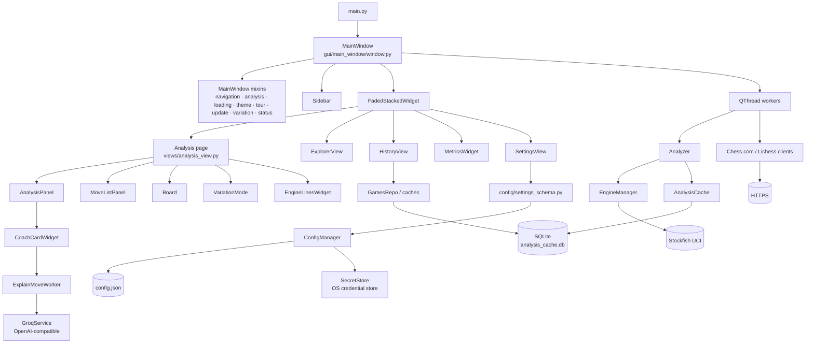

# Architecture

Canonical reference for the Chess Analyzer Pro codebase: layers, runtime flows,
every source file's purpose, the patterns we follow, and where to make common
changes. It describes the v2.5.0 layout.

**Audience:** new contributors, maintainers, and AI agents working in the repo.
For setup and a first change, read [onboarding_doc.md](onboarding_doc.md); for
process rules, read [CONTRIBUTING.md](../CONTRIBUTING.md); for agent guardrails,
read [AGENTS.md](../AGENTS.md).

---

## 1. Reading guide

1. [System overview](#2-system-overview) — how the pieces fit together.
2. [Runtime flows](#3-runtime-flows) — what happens when you click something.
3. [File reference](#4-file-reference) — what each module is for.
4. [Patterns](#5-patterns-we-follow) — the rules that keep the codebase coherent.
5. [Invariants](#6-domain-invariants) — never regress these.
6. [Extension recipes](#7-extension-recipes) — step-by-step for common changes.
7. [Task index](#8-task--file-index) — jump straight to the right file.

---

## 2. System overview



### Layers and dependency direction

```text
main.py
  └── src/gui/**        presentation only (PyQt6)
        └── src/backend/**   domain logic (zero Qt imports)
              └── src/utils/**, src/constants.py   leaf helpers
```

Allowed edges:

- `gui` → `backend`, `gui` → `utils`, `gui` → `constants`, `gui` → `config`
- `backend` → `utils`, `backend` → `constants`, `backend` → `config` (schema only)
- `utils` → `constants`; `utils` never imports `gui` or `backend`
- `config` → `constants` (Qt-free)

Forbidden edges:

- `backend` importing PyQt6 or any `src.gui` module
- `utils` importing `src.gui`
- widgets importing `src.gui.components.<subpackage>` directly (use the facade)
- business logic living in a widget or repository
- network calls from the UI thread

### Package responsibilities

| Area | Responsibility |
| --- | --- |
| `src/backend/analysis` | Engine orchestration, classification, metrics, tactics, variations, opening data |
| `src/backend/api` | Chess.com and Lichess REST clients, import limits |
| `src/backend/storage` | SQLite schema, repositories, migrations, PGN parsing, backup |
| `src/backend/services` | LLM and feedback integrations |
| `src/backend/engine` | Stockfish download and binary validation |
| `src/backend/updater` | GitHub release checks and platform installers |
| `src/config` | Single-source settings metadata and defaults (Qt-free) |
| `src/gui/main_window` | Window composition and cross-cutting mixins |
| `src/gui/views` | Full pages and their sub-widgets |
| `src/gui/analysis` | Analysis board, move list, coach, variations, live engine |
| `src/gui/components` | Shared component library, grouped by responsibility |
| `src/gui/dialogs` | Modal flows (load game, wizard, feedback, errors, updates) |
| `src/gui/theme` | Palettes, tokens, motion, OS theme detection |
| `src/gui/styles.py` | One QSS generator per control, driven by the live palette |
| `src/utils` | Config, logging, paths, resources, secrets |

---

## 3. Runtime flows

### Full game analysis

1. `GameLoadingMixin.load_game()` accepts a `GameAnalysis` and hands it to
   `MainWindow.setup_analysis_page()` widgets.
2. `AnalysisMixin.start_analysis()` spawns `AnalysisWorker`, which drives
   `Analyzer.analyze_game()`.
3. `Analyzer` calls `EngineManager` per position, caches results through
   `AnalysisCache`, and converts every score to White's perspective in
   `_process_analysis_results()`.
4. Progress signals update `MoveListPanel`, `Board`, `VariationGraph` and the
   status bar. `AnalysisPanel` renders accuracy, charts and the AI Coach tab.

### Live engine session

1. `LiveEngineSession` (`gui/engine_lines/session.py`) owns one Stockfish
   process and the current FEN.
2. `LiveAnalysisWorker` / session signals feed `EngineLinesWidget`.
3. Session state is mirrored into the status bar via
   `StatusBarMixin._on_live_engine_state()`.
4. On shutdown, every session is `shutdown()`-ed from `MainWindow.closeEvent()`.

### Import (Chess.com, Lichess, PGN, CSV)

1. `LoadGameDialog` hosts the panels in `gui/dialogs/load_game/`.
2. `ApiWorker` runs the request off the UI thread.
3. `ChessComAPI` / `LichessAPI` normalise results into `GameInfo` and
   `GameAnalysis`.
4. `PGNParser` handles files and pasted text; `GameImportWorker` handles CSV.
5. Results are persisted through `GameHistoryManager` → `GamesRepo` / caches.

### AI move explanation

1. `CoachCardWidget` requests an explanation for the current move.
2. `ExplainMoveWorker` builds a deterministic fact sheet from
   `backend/analysis/tactics/insight.py` (classification, eval swing, tactics,
   best line) and calls `GroqService`.
3. The reply is validated against the facts; on failure or no network the
   deterministic fallback text is used.
4. Results are cached with a configurable TTL and rendered in the Coach tab.
5. Full-game summaries use `backend/analysis/game_report.py` and are persisted
   with the game.

### Variations

1. A board move, engine-line click, or “show best move” enters
   `VariationMode`.
2. `VariationMode` mutates the FEN-keyed tree in
   `backend/analysis/variation_tree.py`.
3. `VariationGraph` renders branches; `MoveListPanel` shows saved-tree badges.
4. The tree survives leaving and re-entering variation mode for the session.

### Settings

1. `src/config/settings_schema.py` defines every setting's default, type and
   validation.
2. `SettingsView` builds category cards from `gui/views/settings/*`, using
   `SettingsForm`/`SettingsBinder`.
3. `ConfigManager` persists JSON and `SecretStore` keeps credentials in the OS
   keychain.
4. “Live” settings apply immediately through `MainWindow` slots; others apply on
   save/restart.

### History

1. `HistoryView` builds a `GameQuery` from debounced filters.
2. `GamesRepo` returns one page (`10` detailed / `15` compact).
3. After the page renders, an idle timer prefetches the next page so scrolling
   feels instant.
4. `PaginationBar` and `GameListWidget` share the paging state.

---

## 4. File reference

One row per module. “Key symbols” lists the main public classes/functions, not
every helper. Package `__init__.py` files are re-export facades unless noted.

### Root

| File | Purpose | Key symbols |
| --- | --- | --- |
| `main.py` | Application entry: high-DPI setup, splash, theme bootstrap, `MainWindow` | `main()` |
| `src/constants.py` | App version, URLs, provider presets, defaults, `DEFAULT_BOARD_THEME` | `APP_VERSION`, `PROVIDERS`, `DEFAULT_BOARD_THEME` |

### `src/backend/analysis`

<details>
<summary>Analysis, metrics, tactics, variations, opening data</summary>

| File | Purpose | Key symbols |
| --- | --- | --- |
| `analyzer.py` | Orchestrates the analysis loop, caching, pause/resume and White-perspective conversion | `Analyzer` |
| `engine.py` | Stockfish UCI lifecycle, path resolution, thread/hash configuration | `EngineManager` |
| `engine_line.py` | Shared engine-line model for cached and live output | `EngineLine` |
| `game_report.py` | Factual dossier used to ground full-game AI summaries | `build_game_report` |
| `local_book.py` | Local opening-book manager and result model | `LocalBookManager`, `BookResult` |
| `math_utils.py` | Win-probability, accuracy and expectation helpers | `get_win_probability`, `calculate_move_accuracy`, `apply_accuracy_floor` |
| `move_classifier.py` | Classification heuristics from win-probability loss | `MoveClassifier` |
| `navigation.py` | Move-list navigation helpers shared by shortcuts | `find_critical_move` |
| `opening_db.py` | SQLite ECO opening database lookups | `OpeningDB` |
| `polyglot_book.py` | Polyglot `.bin` opening-book reader | `PolyglotBookManager` |
| `variation_tree.py` | Persistent FEN-keyed variation tree and record models | `VariationNode`, `VariationBranch` |
| `metrics_aggregator.py` | Compatibility re-export of the metrics package | `MetricsAggregator` |

</details>

#### `src/backend/analysis/metrics`

<details>
<summary>Aggregation behind the Stats dashboard and coach dossier</summary>

| File | Purpose | Key symbols |
| --- | --- | --- |
| `aggregator.py` | Orchestrates metric collection across games | `MetricsAggregator` |
| `accumulators.py` | Colour, format, opening and clock accumulators | `ColorStats`, `FormatStats`, `OpeningStats`, `ClockStats` |
| `coach_dossier.py` | Formats aggregated facts for AI Coach prompts | `build_coach_dossier` |
| `constants.py` | Thresholds and shared metric constants | — |
| `filters.py` | Game filtering and player-colour resolution | `filter_games` |
| `models.py` | Typed metric records | `Outcome`, `GameRecord` |
| `termination.py` | Termination classification for charts | `classify_termination` |

</details>

#### `src/backend/analysis/tactics`

<details>
<summary>Deterministic tactical facts used by metrics and the Coach</summary>

| File | Purpose | Key symbols |
| --- | --- | --- |
| `board_utils.py` | Board geometry, ray tracing, piece safety | — |
| `constants.py` | Enums and thresholds for tactics analysis | `GamePhase`, `TacticalTheme`, `MoveQualityBucket` |
| `game.py` | Per-game tactical analysis, phase accuracy, advantage conversion | `MoveCtx`, `TacticsState` |
| `hanging.py` | Deterministic hanging-piece detection | `get_hanging_pieces` |
| `insight.py` | Grounded move-insight builder for Coach explanations | `MoveInsight` |
| `motifs.py` | Fork/pin/skewer motif detection registry | `MotifCtx` |
| `phase.py` | Opening/middlegame/endgame classification | `classify_game_phase` |
| `see.py` | Static Exchange Evaluation minimax | `static_exchange_evaluation` |

</details>

### `src/backend/api`, `cache`, `engine`, `models`, `services`, `updater`

| File | Purpose | Key symbols |
| --- | --- | --- |
| `api/base_api.py` | Shared HTTP client, profile and avatar plumbing | `BaseChessAPI`, `ProfileResult` |
| `api/chess_com_api.py` | Chess.com archive, game and profile endpoints | `ChessComAPI` |
| `api/lichess_api.py` | Lichess NDJSON game export and profile endpoints | `LichessAPI` |
| `api/import_limits.py` | Single source for public-game import caps | `MAX_PUBLIC_GAMES` |
| `cache/api_cache.py` | Legacy in-memory/DB cache facade used by API clients | `ApiGameCache` |
| `engine/downloader.py` | Stockfish release discovery, download and validation | `ReleaseAsset`, `StockfishDownloader` |
| `models/game_info.py` | Lightweight game summary passed between API and UI | `GameInfo` |
| `services/feedback_service.py` | Sends reviews, bug reports and suggestions | `FeedbackService`, `FeedbackWorker` |
| `services/groq_service.py` | Provider-agnostic OpenAI-compatible LLM client | `GroqService` |
| `updater/update_checker.py` | GitHub release check and version comparison | `UpdateChecker`, `UpdateCheckerWorker` |
| `updater/updater.py` | Platform-aware download and installer dispatch | `DownloadWorker` |

### `src/backend/storage`

<details>
<summary>SQLite schema, repositories, migrations, PGN, backup</summary>

| File | Purpose | Key symbols |
| --- | --- | --- |
| `db_connection.py` | Connection context manager and performance pragmas | `get_db_connection()` |
| `migrations.py` | Schema creation, versioning and indexes | `init_db` |
| `schema_constants.py` | Column specs and SQL shared by repos | `GAME_COLUMNS` |
| `models.py` | Domain dataclasses and serialisation | `GameAnalysis`, `GameMetadata`, `MoveAnalysis` |
| `game_history.py` | Storage facade over games and caches | `GameHistoryManager` |
| `games_repo.py` | Game persistence, querying and hydration | `GamesRepo` |
| `game_query.py` | Declarative history queries and filters | `GameQuery` |
| `api_cache_repo.py` | Cache of games fetched from external APIs | `ApiCacheRepo` |
| `explorer_cache_repo.py` | Opening-explorer response cache and pruning | `ExplorerCacheRepo` |
| `profile_cache_repo.py` | Cached public profiles and avatars | `ProfileCacheRepo`, `CachedProfile` |
| `cache.py` | Position-level analysis cache | `AnalysisCache` |
| `pgn_parser.py` | PGN file/text parsing and validation | `PGNParser` |
| `historic_games.py` | Curated historic positions for the landing puzzle | `HistoricPosition` |
| `termination_detector.py` | Termination reason detection | `TerminationDetector` |
| `stats.py` | Read-only storage usage report | `StorageStats` |
| `backup.py` | Validated backup/restore with safety copy | `BackupSummary`, `BackupError` |

</details>

### `src/config` and `src/utils`

| File | Purpose | Key symbols |
| --- | --- | --- |
| `config/settings_schema.py` | Single source of settings metadata, defaults and validation | `SettingSpec`, `Choice` |
| `utils/config.py` | JSON config persistence and shared singleton | `ConfigManager` |
| `utils/logger.py` | Logging setup, rotation and token redaction | `logger`, `SensitiveDataFilter` |
| `utils/path_utils.py` | Resource and user-data paths (no Qt) | `get_resource_path`, `get_user_data_dir` |
| `utils/resources.py` | Image, icon and sound loading | `ResourceManager` |
| `utils/secrets.py` | OS credential store with migration and fallback | `SecretStore` |

### `src/gui/main_window`

| File | Purpose | Key symbols |
| --- | --- | --- |
| `window.py` | Window composition, splitter layout, landing board, shutdown | `MainWindow` |
| `navigation_mixin.py` | Page switching, move stepping, replay, shortcuts glue | `NavigationMixin` |
| `analysis_mixin.py` | Full-analysis lifecycle and status updates | `AnalysisMixin` |
| `game_loading_mixin.py` | Loading, staging and analysing games | `GameLoadingMixin` |
| `variation_mixin.py` | Variation-mode request handling | `VariationMixin` |
| `theme_mixin.py` | Palette application and theme refresh fan-out | `ThemeMixin` |
| `status_bar_mixin.py` | Engine pill, status messages, spinner, toasts | `StatusBarMixin` |
| `tour_mixin.py` | Tour start/finish and seen-state | `TourMixin` |
| `update_mixin.py` | Update check/download orchestration | `UpdateMixin` |

### `src/gui/views`

<details>
<summary>Pages and their sub-widgets</summary>

| File | Purpose | Key symbols |
| --- | --- | --- |
| `analysis_view.py` | Facade re-exporting the analysis page widgets | — |
| `explorer/view.py` | Opening Explorer composition, board/navigation state | `ExplorerView` |
| `explorer/ui_mixin.py` | Page layout, controls and theme refresh | `ExplorerUiMixin` |
| `explorer/book_mixin.py` | Local/Polyglot/Lichess rows and loading skeleton | `ExplorerBookMixin` |
| `explorer/online_mixin.py` | Token gate, cache, debounce and worker lifecycle | `ExplorerOnlineMixin` |
| `explorer/engine_mixin.py` | Live engine lines, eval status and classification | `ExplorerEngineMixin` |
| `explorer/book_skeleton.py` | Pulsing placeholder rows while Lichess loads | `ExplorerBookSkeleton` |
| `explorer/book_row.py` | One opening-book row | `BookRowWidget` |
| `explorer/ratio_bar.py` | Win/draw/loss ratio bar | `RatioBar` |
| `explorer/lichess_worker.py` | Off-thread Lichess explorer lookup | `LichessExplorerWorker` |
| `explorer/types.py` | Shared explorer typing | `ClassificationContext` |
| `history_view.py` | Game history page: filters, paging, import | `HistoryView`, `GameImportWorker` |
| `metrics_view.py` | Stats dashboard shell | `MetricsWidget` |
| `settings_view.py` | Settings shell: category rail, search, cards | `SettingsView` |

</details>

#### `src/gui/views/metrics`

<details>
<summary>Dashboard cards; every card follows the MetricCard lifecycle</summary>

| File | Purpose | Key symbols |
| --- | --- | --- |
| `base_card.py` | Card shell and content lifecycle | `MetricCard` |
| `card_registry.py` | Stable card metadata for ordering/pinning | `DashboardCardSpec` |
| `accuracy_trend_card.py` | Accuracy over time | `AccuracyTrendCard` |
| `advantage_card.py` | Advantage conversion and comebacks | `AdvantageConversionCard` |
| `move_quality_card.py` | Classification distribution | `MoveQualityCard` |
| `phase_performance_card.py` | Opening/middlegame/endgame accuracy | `PhasePerformanceCard` |
| `openings_list_card.py` | Opening mastery list | `OpeningsListCard` |
| `tactical_themes_card.py` | Tactical motif frequency | `TacticalThemesCard` |
| `hanging_pieces_card.py` | Hanging-piece awareness | `HangingPiecesCard` |
| `ending_distribution_card.py` | Termination distribution | `EndingDistributionCard` |
| `brilliancy_hall_card.py` | Best brilliancies | `BrilliancyHallCard` |
| `ai_coach_card.py` | AI Coach insights card | `AICoachCard` |
| `time_management_card.py` | Compatibility import for the time card | `TimeManagementCard` |
| `time/time_card.py` | Time & clock analytics shell | `TimeManagementCard` |
| `time/time_formats_view.py` | Formats subpage | `FormatsView` |
| `time/time_pace_view.py` | Move-pace subpage | `PaceView` |
| `time/time_trouble_view.py` | Time-trouble subpage | `TroubleView` |
| `time/panels.py` | Shared panels for the time card | `IconTile`, `StatPanel` |

</details>

#### `src/gui/views/settings`

<details>
<summary>One card per settings area, plus shared form components</summary>

| File | Purpose | Key symbols |
| --- | --- | --- |
| `components.py` | Settings form, rows, path field, binder | `SettingsForm`, `SettingsBinder`, `PathField` |
| `helpers.py` | Small settings helpers | — |
| `modern_widgets.py` | Custom settings controls | `ModernSliderCounter` |
| `background_card.py` | Base card for off-thread settings work | `BackgroundTaskCard` |
| `background_worker.py` | Generic settings background worker | `BackgroundTaskWorker` |
| `engine_settings.py` | Engine path and parameters | `EngineSettings` |
| `full_analysis_settings.py` | Full-game analysis options | `FullAnalysisSettings` |
| `live_analysis_settings.py` | Live engine options | `LiveAnalysisSettings` |
| `board_pieces_settings.py` | Board theme and piece set | `BoardPiecesSettings` |
| `board_preview.py` | Board/piece previews | `BoardThemePreview` |
| `book_settings.py` | Opening book configuration | `BookSettings` |
| `coach_settings.py` | AI Coach explanation options | `CoachSettings` |
| `api_settings.py` | LLM provider configuration | `ApiSettings` |
| `player_settings.py` | Accounts, credentials, import network | `ChessComCard`, `LichessCard` |
| `profile_preview.py` | Public profile preview | `ProfilePreview` |
| `storage_settings.py` | Storage usage and data-folder access | `StorageSettings` |
| `storage_actions.py` | Shared storage action helpers | — |
| `storage_card.py` | Compatibility alias | — |
| `storage_worker.py` | Compatibility alias for the background worker | — |
| `backup_settings.py` | Backup and restore | `BackupSettings` |
| `retention_settings.py` | Cache TTLs and capacity | `RetentionSettings` |
| `maintenance_settings.py` | Cache clearing and VACUUM | `MaintenanceSettings` |
| `danger_settings.py` | Destructive reset | `DangerSettings` |
| `theme_accent_settings.py` | Theme mode and accent | `ThemeAccentSettings` |
| `window_layout_settings.py` | Window and sidebar layout | `WindowLayoutSettings` |
| `dashboard_layout_settings.py` | Dashboard card ordering | `DashboardLayoutSettings` |
| `shortcut_settings.py` | Shortcut presets | `ShortcutSettings` |
| `sound_settings.py` | Sound feedback | `SoundSettings` |
| `links_settings.py` | About, links, update actions | `LinksSettings` |

</details>

### `src/gui/analysis`

| File | Purpose | Key symbols |
| --- | --- | --- |
| `analysis_panel.py` | Report card, graphs, stats and AI Coach host | `AnalysisPanel`, `GenerateSummaryThread` |
| `analysis_worker.py` | Full-game analysis QThread | `AnalysisWorker` |
| `coach_card_widget.py` | Per-move explanation surface | `CoachCardWidget`, `CoachState` |
| `coach_worker.py` | Off-thread explanation request and rate limiting | `ExplainMoveWorker`, `RequestLimiter` |
| `captured.py` | Captured pieces and material advantage | `CapturedPiecesWidget` |
| `controls.py` | First/prev/next/last/flip controls | `GameControlsWidget` |
| `explorer_move_list.py` | Lightweight explorer move list | `ExplorerMoveListWidget` |
| `line_utils.py` | Engine-line presentation helpers | — |
| `live_analysis.py` | Live position analysis worker | `LiveAnalysisWorker` |
| `move_cell_widget.py` | One move cell with badge and think time | `MoveCellWidget` |
| `move_list_panel.py` | Move table, selection, variation badges | `MoveListPanel` |
| `variation_graph.py` | Git-style branch strip | `VariationGraph` |
| `variation_mode.py` | Board state machine for variation trees | `VariationMode` |

### `src/gui/board`, `engine_lines`, `metrics`

| File | Purpose | Key symbols |
| --- | --- | --- |
| `board/board.py` | The single configurable board used everywhere | `Board`, `BoardConfig` |
| `board/board_panel.py` | Board with captured rows and clocks | `BoardPanel` |
| `board/board_game_header.py` | Matchup header hugging the board width | `BoardGameHeader` |
| `board/eval_bar.py` | Evaluation bar | `EvalBarWidget` |
| `board/piece_themes.py` | Piece SVG loading and theme resolution | — |
| `board/promotion_dialog.py` | Promotion picker | `PromotionDialog` |
| `engine_lines/config.py` | Shared engine-lines configuration | `EngineLinesConfig` |
| `engine_lines/session.py` | Shared live-engine session | `LiveEngineSession` |
| `engine_lines/widget.py` | Engine-lines panel and rows | `EngineLinesWidget`, `EngineLineRow` |
| `metrics/charts.py` | Matplotlib chart builders | — |
| `metrics/drill_down_view.py` | Position-level stats explorer | `DrillDownView` |
| `metrics/drill_down_item.py` | One drill-down occurrence row | `DrillDownItemWidget` |
| `metrics/workers.py` | Stats and AI-insight workers | `StatsWorker`, `InsightWorker` |

### `src/gui/components` (use the facade, not these paths)

<details>
<summary>controls/ — interactive controls</summary>

| File | Purpose | Key symbols |
| --- | --- | --- |
| `button.py` | The only button widget | `Button`, `ButtonVariant`, `ButtonSize` |
| `input.py` | Input, text area, numeric editors | `Input`, `TextArea`, `InputVariant` |
| `select.py` | The only dropdown | `Select`, `SelectOption` |
| `tabs.py` | Underline/segmented tabs | `Tabs`, `TabVariant` |
| `date_picker.py` | Outlined date picker with calendar popup | `DatePicker` |
| `form_field.py` | Label + control + helper/error | `FormField` |
| `segmented_control.py` | Chip selector built on `Button` | `SegmentedControl` |
| `segmented_bar.py` | Proportional multi-segment bar | `SegmentedBar` |
| `star_rating_widget.py` | 5-star rating input | `StarRatingWidget` |

</details>

<details>
<summary>display/ — data visualisation</summary>

| File | Purpose | Key symbols |
| --- | --- | --- |
| `graph_widget.py` | Evaluation graph | `GraphWidget` |
| `circular_accuracy.py` | Circular accuracy gauge | `CircularAccuracyWidget` |
| `stat_card.py` | Stat tiles | `StatCard`, `SimpleStatCard` |
| `mini_bar.py` | Compact progress bar | `MiniBar` |

</details>

<details>
<summary>feedback/ — states, loading, notifications</summary>

| File | Purpose | Key symbols |
| --- | --- | --- |
| `toast.py` | The only notification system | `Toast`, `ToastManager`, `ToastVariant` |
| `toast_icons.py` | Painted outline glyphs | — |
| `empty_state.py` | Shared empty state | `EmptyState` |
| `status_badge.py` | Header/status pill | `StatusBadge` |
| `loading_widget.py` | Full-window loading overlay | `LoadingOverlay` |
| `pulsing_skeleton.py` | AI-writing skeleton | `PulsingSkeleton` |

</details>

<details>
<summary>layout/ — page-level containers</summary>

| File | Purpose | Key symbols |
| --- | --- | --- |
| `sidebar.py` | Navigation rail | `Sidebar` |
| `welcome_panel.py` | Landing project hub | `WelcomePanel` |
| `transition_stack.py` | Cross-fade page stack | `FadedStackedWidget` |
| `tour_manager.py` | Tour state machine | `TourManager`, `TourStep` |
| `tour_overlay.py` | Tour highlights and tooltips | `TourOverlay` |
| `masonry_layout.py` | Column-packing layout | `MasonryLayout` |
| `stats_layout.py` | Adaptive stats-card layout | `StatsLayout` |

</details>

<details>
<summary>lists/ — collections and paging</summary>

| File | Purpose | Key symbols |
| --- | --- | --- |
| `game_list_widget.py` | Paged, append-only game list | `GameListWidget` |
| `game_list_item_widget.py` | Detailed/compact game card | `GameListItemWidget` |
| `pagination_bar.py` | Shared paging model and bar | `PaginationBar`, `PaginationState` |
| `legend_list.py` | Chart legends | `LegendList` |
| `sortable_item_list.py` | Drag-and-drop reorder list | `SortableItemList` |

</details>

### `src/gui/dialogs`

<details>
<summary>Modal flows</summary>

| File | Purpose | Key symbols |
| --- | --- | --- |
| `load_game_dialog.py` | Unified Load Game dialog | `LoadGameDialog` |
| `load_game/online_fetch_panel.py` | Chess.com/Lichess fetch panel | `OnlineFetchPanel` |
| `load_game/pgn_file_panel.py` | PGN file panel | `PgnFilePanel` |
| `load_game/pgn_text_panel.py` | PGN text panel | `PgnTextPanel` |
| `load_game/api_worker.py` | Off-thread API fetch | `ApiWorker` |
| `load_game/inline_game_list.py` | Inline results list | `InlineGameList` |
| `load_game/game_card.py` | Result card | `GameCard` |
| `load_game/drop_zone.py` | File drop zone | `DropZone` |
| `load_game/helpers.py` | Shared helpers | — |
| `setup_wizard.py` | First-run wizard and engine/LLM test workers | `SetupWizard` |
| `wizard/wizard_pages.py` | Wizard pages | — |
| `wizard/wizard_nav_bar.py` | Step indicator | `WizardNavBar` |
| `feedback_dialog.py` | Review/bug/feature dialog | `FeedbackDialog` |
| `review_prompt_dialog.py` | In-app review prompt | `ReviewPromptDialog` |
| `shortcut_help_dialog.py` | Shortcut cheat sheet | `ShortcutHelpDialog` |
| `engine_error_dialog.py` | Missing/broken engine guidance | `EngineNotFoundDialog` |
| `llm_error_dialog.py` | Unconfigured LLM guidance | `LlmNotConfiguredDialog` |
| `game_selection_dialog.py` | Multi-game selection | `GameSelectionDialog` |
| `update_dialog.py` | Release notes and download | `UpdateNotificationDialog` |
| `splash_screen.py` | Branded startup splash | `SplashScreen` |

</details>

### `src/gui/theme`, `styles.py`, `utils`

| File | Purpose | Key symbols |
| --- | --- | --- |
| `theme/palette.py` | Light/dark palettes, classification colours, board themes | `LIGHT`, `DARK`, `BOARD_THEMES` |
| `theme/manager.py` | Active mode/accent, signals, stylesheet application | `ThemeManager` |
| `theme/tokens.py` | Spacing, radius and type scale | `Spacing`, `Radius`, `TypeScale` |
| `theme/motion.py` | Durations, easings, animation helpers | `Motion`, `MotionDuration` |
| `theme/system.py` | OS theme/accent detection | `OSThemeWatcher` |
| `styles.py` | QSS generators for every control | `Styles` |
| `utils/debounce.py` | Single-shot debouncer | `Debouncer` |
| `utils/gui_utils.py` | Widget factories and GUI helpers | `create_button` |
| `utils/shortcut_manager.py` | Central shortcut registry and presets | `ShortcutManager`, `ShortcutAction` |
| `utils/smooth_scroll.py` | Shared smooth wheel scrolling | `SmoothScrollRouter` |

### Repository-level folders

| Path | Purpose |
| --- | --- |
| `tests/` | `backend/`, `gui/`, `storage/` suites with shared `conftest.py`; 85% branch floor, GUI excluded |
| `assets/` | Images, icons, sounds, piece SVGs (third-party pieces documented separately) |
| `planning/` | `2.5.0_progress.md` release tracking plus feature/design plans |
| `docs/` | This reference, onboarding tutorial, user guide |
| `installers/` | Platform packaging scripts and outputs |
| `build.spec` | PyInstaller bundle definition |

---

## 5. Patterns we follow

| Pattern | Rule | Example | Anti-pattern |
| --- | --- | --- | --- |
| Qt-free backend | No PyQt6 imports under `src/backend`, `src/utils`, `src/config` | `Analyzer` returns data, never widgets | Importing `pyqtSignal` in a repo |
| Component facade | Import shared widgets from `src.gui.components` only | `from src.gui.components import Button, Select` | Importing `components.controls.button` |
| One widget per control | Never construct raw `QPushButton`, `QLineEdit`, `QComboBox` or write button QSS | `Button`, `Input`, `Select`, `Tabs` | Local QSS strings in a view |
| One style generator | Each control's look comes from a `Styles.get_*_qss()` generator | `Styles.get_button_qss` | Hex colours or per-widget stylesheets |
| Live theming | Per-widget styles are rebuilt on theme/accent change | `_refresh_historic_bar_styles()` | Capturing palette colours at construction |
| Settings schema | Defaults, types and validation live in `settings_schema.py` | `SettingSpec("board_theme", …)` | Ad-hoc `config.get("x", default)` in widgets |
| Off-thread work | QThread subclasses + signals; never block the event loop | `AnalysisWorker`, `ApiWorker`, `ExplainMoveWorker` | Network/engine calls in a slot |
| Worker lifetime | Cancel, disconnect and delete workers on close | `MainWindow.closeEvent()` | Orphaned threads on dialog close |
| Domain before storage | Repositories persist; domain services compute | Tactics computed in `backend/analysis/tactics` | SQL that classifies moves |
| Repository facade | One `GameHistoryManager` over focused repos | `GamesRepo`, `ExplorerCacheRepo` | Views opening SQLite directly |
| Context-managed DB | Connections, pragmas and transactions in one helper | `db_connection.connect()` | Manual commit/rollback everywhere |
| Single column spec | Derive DDL, INSERTs and row dicts from one tuple | `GAME_COLUMNS` | Parallel column lists |
| Model serialisation | `to_dict`/`from_dict` live on the dataclass | `MoveAnalysis.to_dict()` | Ad-hoc dict building in UI |
| Symmetric sides | Iterate `("white", "black")` instead of copy-paste | Phase accuracy, tactics extraction | Duplicated White/Black blocks |
| Shared sessions | One live-engine session per surface | `LiveEngineSession` | Spawning Stockfish per widget |
| Debounce/throttle | Coalesce high-frequency UI work | `Debouncer`, 10 Hz engine-line updates | Recomputing on every signal |
| Paged data | Page + idle prefetch instead of loading everything | `HistoryView` (10/15 per page) | Loading 1,000 games at once |
| Offline fallback | Deterministic text/data when the network is unavailable | Coach fallback, cached explorer | Blank screen on failure |
| Toast-driven tasks | Long work shows loading → success/error | Backup, import, analysis, updates | Silent blocking operations |
| Layered errors | `logger` for diagnostics, toast/dialog for users | `logger.error` + `show_toast` | `print()` or swallowed exceptions |

### Naming and file conventions

- Modules are `snake_case`; Qt widget classes are `PascalCase` and suffixed with
  their role (`Card`, `Panel`, `Widget`, `Dialog`, `View`, `Mixin`).
- One primary class per module; helpers stay private (`_helper`).
- Pages live in `views/`, reusable pieces in `components/`, page-specific
  sub-widgets next to their page (`views/metrics/`, `views/settings/`).
- Backend services never know about UI state; they accept and return domain
  objects.
- Compatibility shims (`storage_card.py`, `time_management_card.py`) exist for
  import stability; add new code to the real module, not the shim.

---

## 6. Domain invariants

| Invariant | Rule | Why / failure mode |
| --- | --- | --- |
| White-perspective scores | `MoveAnalysis` evals are always White-positive; flip once in `Analyzer._process_analysis_results()` | Double-flipping makes the eval bar and accuracy contradict each other |
| Accuracy floor | Per-move accuracy never drops below 10.0% | One blunder would collapse game accuracy to zero |
| Deterministic game ID | `md5(pgn_content)` | Prevents duplicate history rows and unstable caches |
| Engine lifecycle | Always stop the engine in `finally`; restart for each fresh analysis | Leaked processes, stale UCI state |
| Thermal safety | Default `multi_pv=2`, `threads=1`, `hash=128MB`; recommend `min(cpu_count, 4)` | Higher values throttle laptops |
| Chess960 | Detect variant tags, set `UCI_Chess960`, build `chess.Board(fen, chess960=True)` | Illegal castling and engine mismatches |
| Offline-first | Analysis, PGN, books and history work with no network | Core product promise |
| Theme contract | Every widget restyles on theme/accent change | Invisible text on light/dark switches |
| Default board | New installs use `DEFAULT_BOARD_THEME` (Brown) | Consistent first-run look |
| Status bar idle | Idle shows only `● Engine ready` | Avoids redundant “Ready” noise |

---

## 7. Extension recipes

### Add a page

1. Create the view in `src/gui/views/` (sub-widgets in a matching subpackage).
2. Add a nav entry in `src/gui/components/layout/sidebar.py` (`nav_specs`).
3. Add the page to `MainWindow.setup_ui()` and `switch_page()`.
4. Add a tour key if the page is toured (`components/layout/tour_manager.py`).
5. Add a GUI test in `tests/gui/`.

### Add a setting

1. Add a `SettingSpec` to `src/config/settings_schema.py` (default, type,
   validation, `apply="live"` when it should apply immediately).
2. Add the control to the relevant card in `src/gui/views/settings/` using
   `SettingsForm`/`SettingsBinder`.
3. Handle the “live” case in `SettingsView` + `MainWindow` (theme, board, engine).
4. Add a test for persistence and the live-apply branch.

### Add a shared component

1. Put it in the right `src/gui/components/<group>/` subpackage.
2. Export it from `src/gui/components/__init__.py`.
3. Generate its look from `Styles`; no widget-local QSS or hex.
4. Restyle on theme/accent change.
5. Add a `pytest-qt` test; use it from call sites via the facade.

### Add an analysis feature

1. Compute domain facts in `src/backend/analysis/` (never in a widget).
2. Extend `MoveAnalysis`/`GameAnalysis` with serialisation on the model.
3. If persisted, update `GAME_COLUMNS` and migrations.
4. Surface it through signals from `AnalysisWorker`/`Analyzer`.
5. Render it in `AnalysisPanel`/`MoveListPanel` with existing components.

### Add an AI fact or provider behaviour

1. Add the deterministic fact in `tactics/insight.py` or `game_report.py`.
2. Format it in `metrics/coach_dossier.py`.
3. Validate the LLM reply against it in `GroqService`.
4. Keep the offline fallback text in sync.

### Add an import source

1. Add a client under `src/backend/api/` extending `BaseChessAPI`.
2. Add the panel under `src/gui/dialogs/load_game/` and wire it in
   `LoadGameDialog`.
3. Run requests through `ApiWorker`; normalise to `GameInfo`/`GameAnalysis`.
4. Respect `import_limits.py`; cache through the storage repos.
5. Mock the HTTP client in tests.

### Add a metrics card

1. Subclass `MetricCard` in `src/gui/views/metrics/`.
2. Register it in `card_registry.py` with a stable key.
3. Use `new_content()`/`clear_content()`/`show_empty()` and shared components
   (`EmptyState`, `StatusBadge`, `SegmentedControl`, `LegendList`, `MiniBar`).
4. Compute the numbers in `backend/analysis/metrics/`.

### Add a test

- Backend: `tests/backend/`, fake engine/HTTP, `tmp_path` for storage.
- GUI: `tests/gui/` with `pytest-qt`; run workers synchronously.
- Never use `time.sleep`/`QTest.qWait`; wait on conditions.
- Keep the full suite under 20 seconds.

---

## 8. Task → file index

| I want to change… | Go to |
| --- | --- |
| Move classification thresholds | `backend/analysis/move_classifier.py` |
| Accuracy or win-probability maths | `backend/analysis/math_utils.py` |
| Engine options, path, lifecycle | `backend/analysis/engine.py` |
| AI Coach explanation prompt/facts | `backend/analysis/tactics/insight.py`, `services/groq_service.py` |
| Full-game AI summary | `backend/analysis/game_report.py`, `analysis_panel.py` |
| Variation behaviour | `backend/analysis/variation_tree.py`, `gui/analysis/variation_mode.py` |
| Metrics calculations | `backend/analysis/metrics/` |
| Metrics dashboard layout | `gui/views/metrics/`, `card_registry.py` |
| History paging/filters | `gui/views/history_view.py`, `backend/storage/game_query.py` |
| Settings defaults | `config/settings_schema.py` |
| Settings card layout | `gui/views/settings/` |
| Colours, palettes, board themes | `gui/theme/palette.py` |
| Control styling | `gui/styles.py` |
| Button/input/select behaviour | `gui/components/controls/` |
| Sidebar/navigation | `components/layout/sidebar.py`, `main_window/navigation_mixin.py` |
| Status bar | `main_window/status_bar_mixin.py` |
| Load Game dialog | `gui/dialogs/load_game_dialog.py`, `dialogs/load_game/` |
| Database schema/migrations | `backend/storage/schema_constants.py`, `migrations.py` |
| Backup/restore | `backend/storage/backup.py`, `views/settings/backup_settings.py` |
| Shortcuts | `gui/utils/shortcut_manager.py` |
| Theme/accent application | `gui/theme/manager.py`, `main_window/theme_mixin.py` |
| Landing puzzle | `main_window/window.py`, `backend/storage/historic_games.py` |

---

## 9. Documentation maintenance

- **New module or package:** add a row to §4 in the same PR.
- **Changed dependency direction or invariant:** update §2 or §6.
- **New shared component or setting:** add it to the component catalog in
  [onboarding_doc.md](onboarding_doc.md) and the relevant recipe here.
- **Do not duplicate this file.** README, AGENTS, CONTRIBUTING and onboarding
  link here for trees and file purposes; they keep only what is unique to them.
- This document describes the **v2.5.0** layout; update the version note when the
  structure changes materially.
